[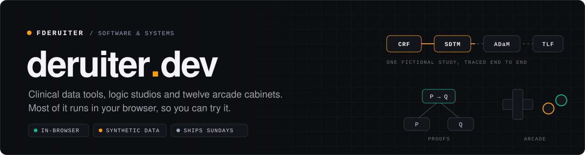](https://deruiter.dev)

Fred de Ruiter's portfolio site. Most of the work on it runs in your browser, so you can try it instead of reading about it.

[](https://github.com/fderuiter/deruiter.dev/actions/workflows/ci.yml?query=branch%3Amain)
[](https://github.com/fderuiter/deruiter.dev/actions/workflows/study-data-core.yml?query=branch%3Amain)
[](https://github.com/fderuiter/deruiter.dev/actions/workflows/synthetic-probes.yml?query=branch%3Amain)
[](https://github.com/fderuiter/deruiter.dev/actions/workflows/weekly-train.yml)
[](https://github.com/fderuiter/deruiter.dev/releases/latest)
[](LICENSE)

[](https://nextjs.org)
[](https://react.dev)
[](https://github.com/fderuiter/deruiter.dev/blob/main/adr/0072-typescript-7-compiler.md)
[](https://nodejs.org)
[](#accessibility)

**[deruiter.dev](https://deruiter.dev)** · [Architecture](ARCHITECTURE.md) · [Decision records](https://github.com/fderuiter/deruiter.dev/tree/main/adr) · [Docs](docs/README.md) · [Contributing](CONTRIBUTING.md) · [Releases](https://github.com/fderuiter/deruiter.dev/releases)

Design a case report form, then follow one fictional study from
protocol to analysis tables with every number traced back to where it came
from. Build a logic proof one step at a time. Rotate a brain. Then, when
you've earned it, play twelve games, several of which are about clinical
data and one of which is about setting up a wedding mostly bought at Costco.

[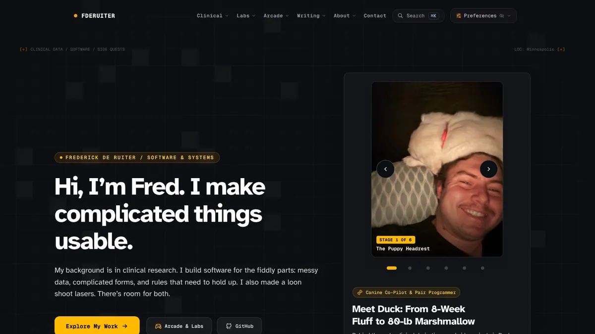](https://deruiter.dev)

## Contents

- [What's inside](#whats-inside)
- [The clinical data journey](#the-clinical-data-journey)
- [The arcade](#the-arcade)
- [Built with](#built-with)
- [Run it locally](#run-it-locally)
- [How it's checked](#how-its-checked)
- [How it ships](#how-it-ships)
- [Accessibility](#accessibility)
- [Documentation](#documentation)
- [Contributing](#contributing)
- [License](#license)

## What's inside

The site is grouped the way the top bar is: Clinical, Labs, Arcade, Writing
and About ([ADR 0058](https://github.com/fderuiter/deruiter.dev/blob/main/adr/0058-site-navigation-information-architecture.md)).

| Area     | What you can do                                                                                                                                                                                                                                                  | Start here                                                                                      |
| -------- | ---------------------------------------------------------------------------------------------------------------------------------------------------------------------------------------------------------------------------------------------------------------- | ----------------------------------------------------------------------------------------------- |
| Clinical | Design forms in CRF Studio, feel a protocol amendment land in Protocol Drift, run the Study Data Pipeline in your browser, and govern eight fictional studies on the Clinical Data Platform: dashboards, a metrics explorer, a SQL workbench and a data catalog. | [/clinical](https://deruiter.dev/clinical)                                                      |
| Labs     | The Proof Workspace for step-by-step logic, NeuroRecon Studio for 3D MRI brain viewing, the Incident Simulator for outage triage, and Patrol Shift, a Midwest ski-patrol judgment simulator.                                                                     | [/labs](https://deruiter.dev/labs)                                                              |
| Arcade   | Twelve cabinets: Study Director, Trial & Error: Biostat Ops, Clinical Trial Chaos, Protocol Drift, Laser Loon, Patty's Drive-Thru, For Better or Bulk, Working With Duck, Monkey C Mayhem, Retro Labyrinth, Quasi-Perfect Puzzler and Meme Vault.                | [/arcade](https://deruiter.dev/arcade)                                                          |
| Writing  | A blog on what's being built and what it taught, and case studies on the decisions behind each project and where it stops.                                                                                                                                       | [/blog](https://deruiter.dev/blog) · [/case-studies](https://deruiter.dev/case-studies)         |
| About    | Background, office hours, how the site itself works, and credits for the open-source projects it stands on.                                                                                                                                                      | [/stack](https://deruiter.dev/stack) · [/acknowledgments](https://deruiter.dev/acknowledgments) |

| [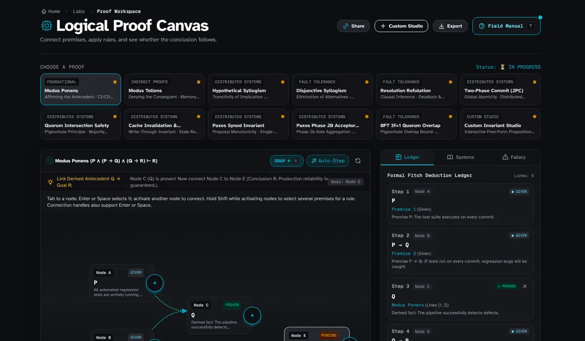](https://deruiter.dev/proof) | [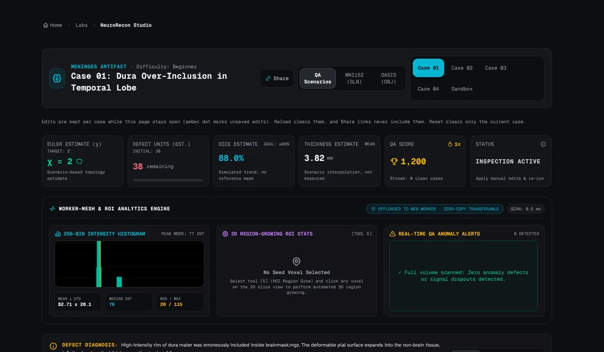](https://deruiter.dev/neuro) |
| :-----------------------------------------------------------------------------------------------------------------------------------------------------------------------------: | :--------------------------------------------------------------------------------------------------------------------------------------------------------------: |
|                                                                  [Proof Workspace](https://deruiter.dev/proof)                                                                  |                                                         [NeuroRecon Studio](https://deruiter.dev/neuro)                                                          |

## The clinical data journey

The Clinical section is one path through one fictional study, DEMO-301, from
the form a site fills in to the portfolio a sponsor governs. The data is
synthetic and the vendors are invented: no real patients were involved, and
nothing here is a validated system.

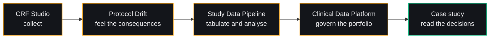

- **[CRF Studio](https://deruiter.dev/crf)** designs case report forms with
  edit checks, a visit schedule and controlled terminology, and exports a
  study the pipeline can run.
- **[Study Data Pipeline](https://deruiter.dev/study-data)** takes DEMO-301
  from a USDM v4 definition through SDTM and ADaM to demographics, adverse
  event and change-from-baseline tables and a Kaplan-Meier figure, with Define-XML 2.1, Dataset-JSON and XPT
  exports and generated reviewer guides. Its own conformance gate checks every
  run, and "Inject an issue" lets you break the data on purpose and watch
  where the gate catches it.
- **[Clinical Data Platform](https://deruiter.dev/platform)** puts DEMO-301
  beside seven other fictional studies, with governed metrics compiled to SQL,
  a read-only SQL workbench running DuckDB in the browser, data contracts,
  lineage and a data quality scorecard.

| [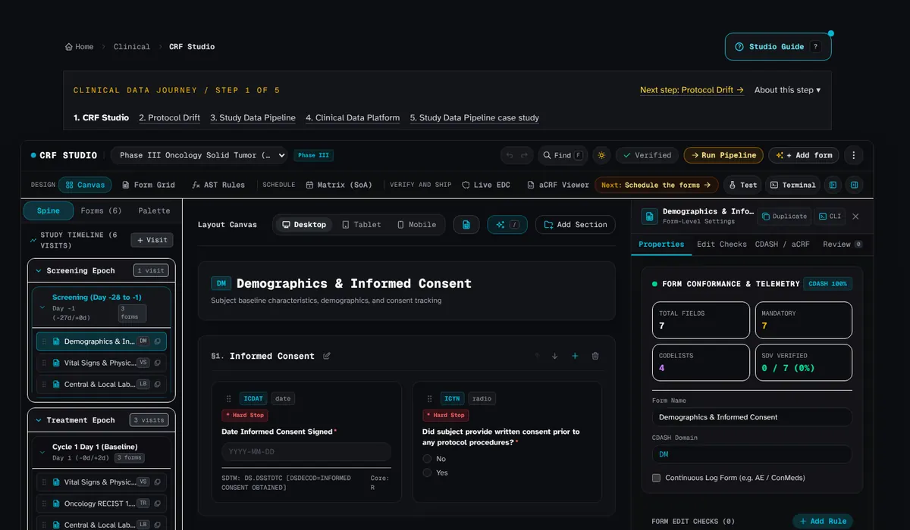](https://deruiter.dev/crf) | [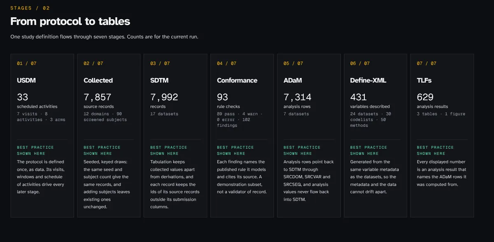](https://deruiter.dev/study-data) | [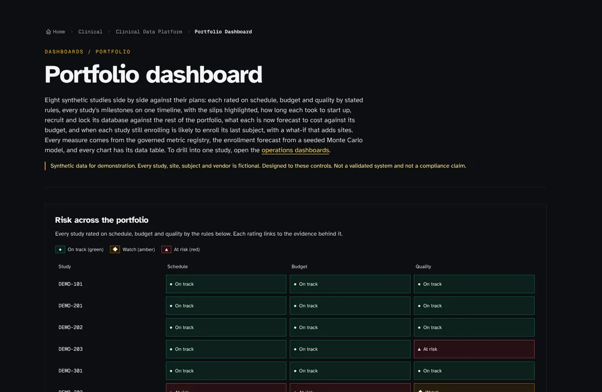](https://deruiter.dev/platform/portfolio) |
| :---------------------------------------------------------------------------------------------------------------------------------------------------------------------------------------------------------------------: | :---------------------------------------------------------------------------------------------------------------------------------------------------------------------------: | :---------------------------------------------------------------------------------------------------------------------------------------------------------------------------------: |
|                                                                                         [CRF Studio](https://deruiter.dev/crf)                                                                                          |                                                            [Study Data Pipeline](https://deruiter.dev/study-data)                                                             |                                                           [Portfolio dashboard](https://deruiter.dev/platform/portfolio)                                                            |

A separate workflow also runs
CDISC's open-source [CORE rules engine](https://github.com/cdisc-org/cdisc-rules-engine)
over the SDTM, Define-XML and USDM outputs of the default study and of every
injected-issue scenario, then commits the findings and fails when they drift
([how to refresh them](https://github.com/fderuiter/deruiter.dev/blob/main/docs/how-to/refresh-cdisc-core-findings.md)).
Using CORE implies no endorsement by CDISC. The design is in
[ADR 0065](https://github.com/fderuiter/deruiter.dev/blob/main/adr/0065-study-data-pipeline-architecture.md)
and [ADR 0066](https://github.com/fderuiter/deruiter.dev/blob/main/adr/0066-clinical-data-platform-architecture.md).

## The arcade

Twelve cabinets, all captured from the current build. Each picture opens its
game.

|          [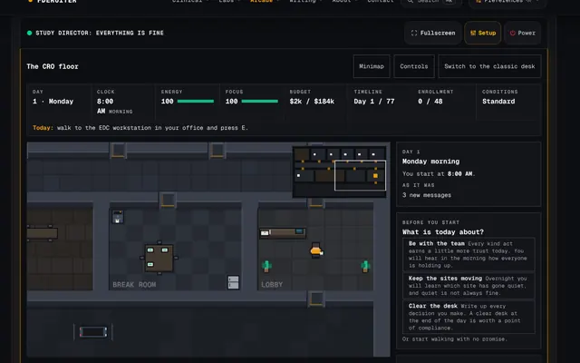](https://deruiter.dev/arcade/study-director)          | [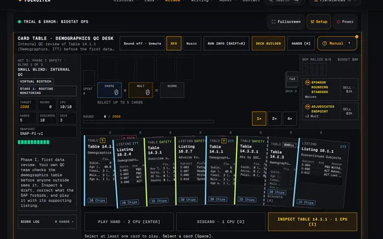](https://deruiter.dev/arcade/trial-and-error) | [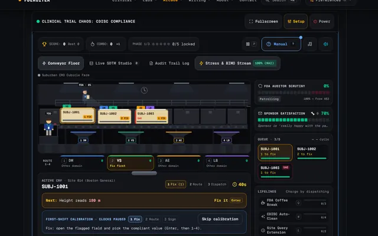](https://deruiter.dev/arcade/clinical-chaos) |
| :-------------------------------------------------------------------------------------------------------------------------------------------------------------------------------: | :-----------------------------------------------------------------------------------------------------------------------------------------------------------------------: | :--------------------------------------------------------------------------------------------------------------------------------------------------------------------: |
|                                                           [Study Director](https://deruiter.dev/arcade/study-director)                                                            |                                                 [Trial & Error: Biostat Ops](https://deruiter.dev/arcade/trial-and-error)                                                 |                                                   [Clinical Trial Chaos](https://deruiter.dev/arcade/clinical-chaos)                                                   |
|          [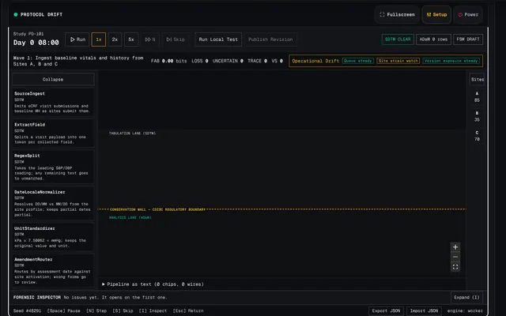](https://deruiter.dev/protocol-drift)          |           [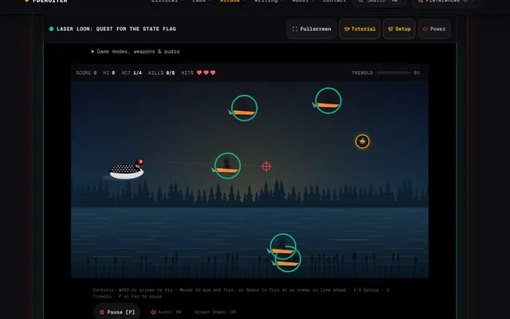](https://deruiter.dev/arcade/laser-loon)           |     [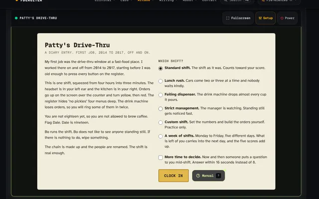](https://deruiter.dev/arcade/patty-drive-thru)      |
|                                                               [Protocol Drift](https://deruiter.dev/protocol-drift)                                                               |                                                           [Laser Loon](https://deruiter.dev/arcade/laser-loon)                                                            |                                                   [Patty's Drive-Thru](https://deruiter.dev/arcade/patty-drive-thru)                                                   |
| [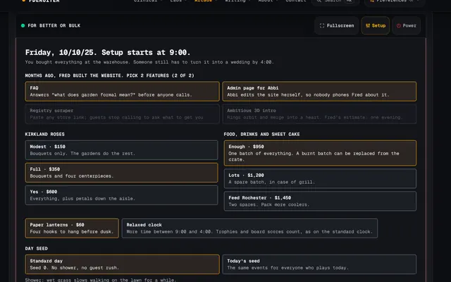](https://deruiter.dev/arcade/for-better-or-bulk) |       [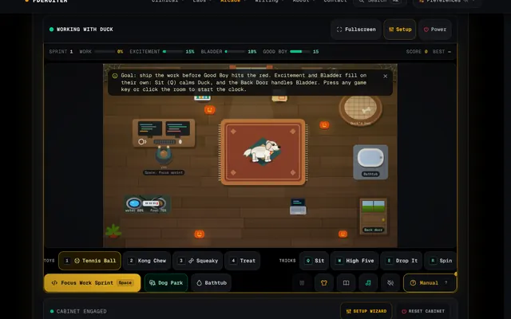](https://deruiter.dev/arcade/working-with-duck)       |          [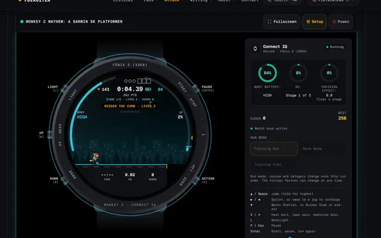](https://deruiter.dev/arcade/garmin-watch)          |
|                                                       [For Better or Bulk](https://deruiter.dev/arcade/for-better-or-bulk)                                                        |                                                    [Working With Duck](https://deruiter.dev/arcade/working-with-duck)                                                     |                                                      [Monkey C Mayhem](https://deruiter.dev/arcade/garmin-watch)                                                       |
|         [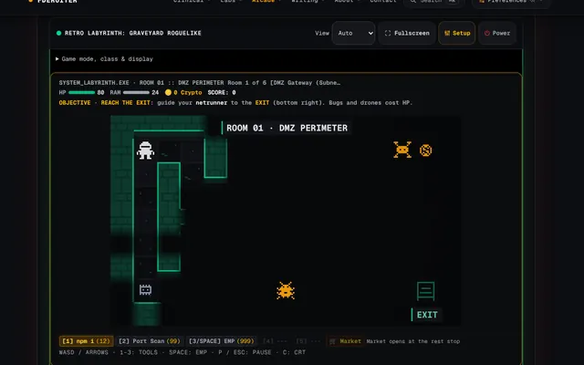](https://deruiter.dev/arcade/retro-labyrinth)          |     [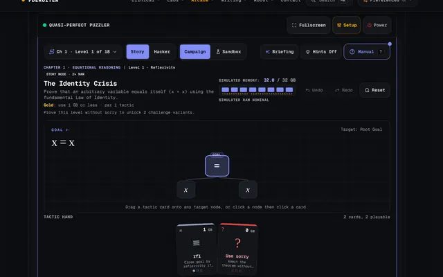](https://deruiter.dev/arcade/quasi-puzzler)     |                   [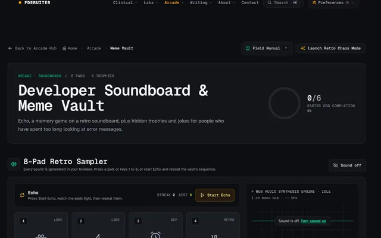](https://deruiter.dev/arcade/meme-vault)                    |
|                                                          [Retro Labyrinth](https://deruiter.dev/arcade/retro-labyrinth)                                                           |                                                    [Quasi-Perfect Puzzler](https://deruiter.dev/arcade/quasi-puzzler)                                                     |                                                          [Meme Vault](https://deruiter.dev/arcade/meme-vault)                                                          |

## Built with


- App: Next.js 16 (App Router), React 19, TypeScript 7 (the Go compiler;
  [ADR 0072](https://github.com/fderuiter/deruiter.dev/blob/main/adr/0072-typescript-7-compiler.md)), Tailwind CSS v4
- Rendering: Canvas 2D and Three.js for the studios and games, [`@chenglou/pretext`](https://github.com/chenglou/pretext) for DOM-free text layout, Framer Motion for transitions
- Data: Prisma 7 on Neon serverless Postgres, Upstash Redis for caching and rate limits, DuckDB-WASM for in-browser SQL, and Zod contracts for every API route ([`openapi.json`](https://github.com/fderuiter/deruiter.dev/blob/main/openapi.json))
- Services: Clerk (admin auth), Resend (email), Sentry (errors and tracing), Vercel (hosting)

Everything runs inside free-tier provider limits, and
[ADR 0036](https://github.com/fderuiter/deruiter.dev/blob/main/adr/0036-free-tier-offloading-and-provider-quota-governance.md)
explains how. Public pages are statically generated and refreshed daily, so a
visit doesn't wake the database.

## Run it locally

You need Node.js 22, 23 or 24 (CI and Vercel use Node 24; `engines.node`
stops before the next major) and npm 10 or newer. npm is the only supported
package manager. Dependency install scripts are allowlisted in
`scripts/install-script-allowlist.json`.

From a fresh clone, run the setup wizard. It checks your toolchain against
`package.json`, installs dependencies with `npm ci`, creates `.env.local`
for the profile you pick, offers each optional integration, and asks before
it applies the schema or loads sample data:

```bash
./scripts/setup.sh
npm run dev
```

Agents and CI use the same command without prompts, for example
`./scripts/setup.sh --non-interactive --skip-db --json`. The
[setup reference](docs/reference/setup.md) lists every flag, profile and
safeguard. For production backup and release-train operator guidance, run
`scripts/setup-operator-wizard.sh backup` or `scripts/setup-operator-wizard.sh release`.

To set it up by hand instead:

```bash
npm install
cp .env.example .env.local   # then set DATABASE_URL to a Postgres connection string
npx prisma db push           # create the schema
npx prisma db seed           # load sample case studies
npm run dev                  # http://localhost:3000
```

`GITHUB_TOKEN` is optional and only avoids GitHub API rate limits. Clerk,
Resend, Upstash and Sentry are optional for local work; `npm run env:check`
reports what is missing. Without them the site uses local stand-ins, so it
still runs. The full walkthrough is in the
[onboarding tutorial](docs/tutorials/01-local-development-and-onboarding.md).

Handy commands once you're in:

| Command                   | What it does                                                              |
| ------------------------- | ------------------------------------------------------------------------- |
| `npm run dev`             | Dev server with a type checker running alongside                          |
| `npm run typecheck`       | Type-checks the whole project with TypeScript 7 (about 25 seconds cold)   |
| `npm test`                | The unit, component and property suites (Vitest)                          |
| `npm run doctor`          | The architecture linter: every repository invariant, with a fix hint each |
| `npm run quality`         | Everything CI's quality gate runs, locally                                |
| `npm run scaffold <type>` | A new game, API route, ADR or case study, wired in everywhere it belongs  |

## How it's checked

Every pull request has to pass these before it merges:

- Vitest unit, component and [fast-check](https://github.com/dubzzz/fast-check)
  property tests: more than 17,000 of them.
- Playwright end-to-end, visual and accessibility (axe-core) suites, plus
  synthetic probes that walk the critical journeys on production daily.
- Stryker mutation testing on the core engines, weekly.
- DX Doctor (`npm run doctor`), which checks the repository's own rules:
  module boundaries, route registration, documentation drift, bundle budgets
  and more.
- A cold TypeScript 7 type check of the whole program, which fails if the
  compiler goes over its memory budget.
- Secret, licence and dependency audits, and zero ESLint warnings.

[`CONTRIBUTING.md`](CONTRIBUTING.md) maps each local command to the CI job
that runs it.

## How it ships

Merging to `main` never deploys. Once a week, Sunday at 7 PM Central, the
weekly train checks that `main` is green and has no destructive migration,
browser-tests the exact release candidate, cuts a versioned
[GitHub Release](https://github.com/fderuiter/deruiter.dev/releases) with
notes written from the commit messages, and asks Vercel to build that commit
([ADR 0063](https://github.com/fderuiter/deruiter.dev/blob/main/adr/0063-weekly-release-train.md)).
v1.0.0, the first release it cut, shipped on 2026-10-27. Anything that
misses a Sunday goes out the next one.

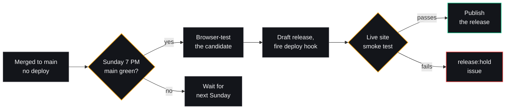

Rollback is Vercel's Instant Rollback. The runbook is
[`DEPLOYMENT.md`](DEPLOYMENT.md), and schema changes follow
[`docs/how-to/write-a-database-migration.md`](docs/how-to/write-a-database-migration.md).

## Accessibility

The site aims for WCAG 2.1 AA on every public page, and CI runs axe-core
against them. You'll find a skip link, focus trapping in every dialog and
drawer, 44px touch targets on touch screens, honoured reduced-motion
settings, a dyslexia-friendly reading mode under Preferences, and text
alternatives and keyboard controls for the canvas-heavy studios. If
something gets in your way, please
[open an issue](https://github.com/fderuiter/deruiter.dev/issues/new/choose);
it counts as a bug.

## Documentation

- [`ARCHITECTURE.md`](ARCHITECTURE.md): route tree, component hierarchy and data flow
- [`adr/`](https://github.com/fderuiter/deruiter.dev/tree/main/adr): seventy architecture decision records, one per significant design choice, including the ones a later record reversed
- [`docs/`](docs/README.md): tutorials, how-to guides, reference (including the TypeDoc API reference) and explanation
- [`CONTEXT.md`](https://github.com/fderuiter/deruiter.dev/blob/main/CONTEXT.md): the project's glossary
- [`DEPLOYMENT.md`](DEPLOYMENT.md) and [`docs/how-to/write-a-database-migration.md`](docs/how-to/write-a-database-migration.md): release and schema-change runbooks
- [Releases](https://github.com/fderuiter/deruiter.dev/releases) for v1.0.0 onward, and [`CHANGELOG.md`](CHANGELOG.md) for the history before it

## Contributing

Issues and pull requests are welcome, from typo fixes to new cabinets.
[`CONTRIBUTING.md`](CONTRIBUTING.md) covers the scaffolding CLI, branch and
commit conventions, and the quality gates. Contributors follow the
[Code of Conduct](CODE_OF_CONDUCT.md). Please report security issues
privately as described in [`SECURITY.md`](SECURITY.md), not in a public
issue.

## License

The application source is licensed under the [Apache License 2.0](LICENSE). The repository ships three kinds of material under three different terms, and [`NOTICE`](NOTICE) is the authoritative scope statement:

- **Application source**: Apache-2.0. `app/`, `components/`, `hooks/`, `lib/`, `types/`, `prisma/`, `scripts/`, `__tests__/`, root configuration, and the generated `docs/` and `openapi.json`.
- **Laser Loon brand artwork** (`public/files/`): [CC0 1.0](public/files/LICENSE.txt) public domain dedication.
- **Editorial content, biography, resume data, photography, and the `Frederick de Ruiter` / `deruiter.dev` marks**: all rights reserved.

Fork the engineering freely; replace the writing and the branding before you deploy.

---

Made in Minnesota, with care, by [Fred](https://deruiter.dev/#about).
