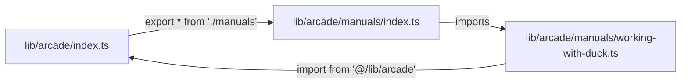
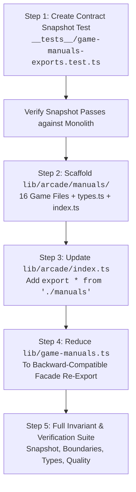

# Architecture Research: Game Manuals Modularization (`lib/arcade/manuals/`)

**Status**: Research & Pre-Implementation Architecture Specification  
**Issue Reference**: #3487 ("refactor(arcade): move game manuals into lib/arcade/manuals with a re-export at the old path")  
**Epic**: #2990  
**Precedent**: Commit [`aed32540b9c8`](https://github.com/fderuiter/deruiter.dev/commit/aed32540b9c86b80cf3e6b5670663046d9511c51) (#3489 / PR #3656)  
**Primary Sources**:
- [`lib/game-manuals.ts`](../../lib/game-manuals.ts) (2,264 lines, monolithic registry)
- [`lib/arcade/registry.ts`](../../lib/arcade/registry.ts) (Arcade game registry and view readiness)
- [`lib/arcade/index.ts`](../../lib/arcade/index.ts) (Arcade package public entry point)
- [`lib/arcade/input/actions.ts`](../../lib/arcade/input/actions.ts#L511) (`manualControlsFromActions` definition)
- [`lib/arcade/achievements/`](../../lib/arcade/achievements/) (Precedent directory structure from #3489)
- [`lib/arcade-achievements.ts`](../../lib/arcade-achievements.ts) (Precedent root re-export facade)
- [`__tests__/arcade-achievements-exports.test.ts`](../../__tests__/arcade-achievements-exports.test.ts) (Precedent contract snapshot test)
- [`.dependency-cruiser.cjs`](../../.dependency-cruiser.cjs) (Boundary and cyclic dependency invariant configuration)
- [`AGENTS.md`](../../AGENTS.md#L189-L196) (Section 21: TS Deep Modules & Architectural Seams)
- [`lib/README.md`](../../lib/README.md) (Deep module architectural rules and package depth boundaries)

---

## Executive Summary

`lib/game-manuals.ts` is currently a monolithic 2,264-line file containing the field manual data (`FieldManualData`) for 16 interactive games and engineering tools. Over recent release cycles, it has been one of the most frequently edited files in the repository.

Issue #3487 specifies modularizing `lib/game-manuals.ts` by decomposing it into individual, per-game modules housed under `lib/arcade/manuals/`, aggregating them via `lib/arcade/manuals/index.ts`, exposing them through the `@/lib/arcade` package entry point, and reducing the existing root `lib/game-manuals.ts` to a zero-overhead, backward-compatible re-export facade.

This document presents the architectural investigation into primary sources, establishes the design blueprint modeled directly on recent precedent commit `aed32540` (#3489), analyzes critical dependency-cruiser boundary rules (specifically avoiding circular dependency cycles through intra-module imports and preserving Trial & Error isolation), audits the 27 consumer files across the repository, and outlines the exact step-by-step execution protocol.

---

## 1. Primary Source Analysis of `lib/game-manuals.ts`

### 1.1 Import Audit

At HEAD ([`lib/game-manuals.ts:1-5`](../../lib/game-manuals.ts#L1-L5)), the module relies on five imports:

```typescript
import { standardCitation } from "@/lib/clinical-standards";
import { FieldManualData } from "@/types/game-manual";
import { manualControlsFromActions } from "@/lib/arcade";
import { DUCK_ACTIONS } from "@/lib/working-with-duck-actions";
import { LABYRINTH_ACTIONS } from "@/lib/retro-labyrinth/actions";
```

An analysis of how each imported symbol is utilized:
1. `standardCitation` from `@/lib/clinical-standards`:
   - Used strictly within `GAME_MANUALS["clinical-chaos"]` ([`lib/game-manuals.ts:964`](../../lib/game-manuals.ts#L964)) to format regulatory citations: ``CDISC ${standardCitation("ODM")} XML``.
   - `lib/clinical-standards` is an external public module entry point. Importing it into `lib/arcade/manuals/clinical-chaos.ts` conforms with `entrypoint-boundary-across-packages` in `.dependency-cruiser.cjs`.
2. `FieldManualData` from `@/types/game-manual`:
   - Used as the TypeScript schema contract typing `GAME_MANUALS: Record<string, FieldManualData>` ([`lib/game-manuals.ts:7`](../../lib/game-manuals.ts#L7)).
   - Defined in `types/game-manual.ts`. Does not reside in `lib/` and thus does not trigger `PACKAGE_INTERNALS` boundary rules.
3. `manualControlsFromActions` from `@/lib/arcade`:
   - Used to generate dynamic field manual control rows from action maps in `GAME_MANUALS["working-with-duck"]` ([`lib/game-manuals.ts:252`](../../lib/game-manuals.ts#L252)) and `GAME_MANUALS["retro-labyrinth"]` ([`lib/game-manuals.ts:1874`](../../lib/game-manuals.ts#L1874)).
   - **Architectural Criticality**: In the monolithic root file, importing from `@/lib/arcade` is valid. However, once moved inside `lib/arcade/manuals/`, importing `@/lib/arcade` introduces a circular dependency cycle (see Section 3.2).
4. `DUCK_ACTIONS` from `@/lib/working-with-duck-actions`:
   - Used in `GAME_MANUALS["working-with-duck"]` ([`lib/game-manuals.ts:252`](../../lib/game-manuals.ts#L252)).
   - `lib/working-with-duck-actions.ts` is a root-level `lib/` file (depth 1), serving as a standalone entry point.
5. `LABYRINTH_ACTIONS` from `@/lib/retro-labyrinth/actions`:
   - Used in `GAME_MANUALS["retro-labyrinth"]` ([`lib/game-manuals.ts:1874`](../../lib/game-manuals.ts#L1874)).
   - `lib/retro-labyrinth/actions.ts` is a package root entry point at depth 2 (`lib/retro-labyrinth/`), which is explicitly re-exported by `lib/retro-labyrinth/index.ts`.

### 1.2 Catalog of the 16 Manual IDs

The monolithic `GAME_MANUALS` object defines exactly 16 manual entries across lines 8 to 2263:

| Index | Manual ID | Title | Route | Line Span | Classification |
| :---: | :--- | :--- | :--- | :--- | :--- |
| 1 | `proof` | Logical Proof Canvas | `/proof` | [8–104](../../lib/game-manuals.ts#L8-L104) | Non-Arcade Tool |
| 2 | `patrol` | Patrol Shift | `/patrol` | [105–234](../../lib/game-manuals.ts#L105-L234) | Non-Arcade Tool |
| 3 | `working-with-duck` | Working With Duck | `/arcade/working-with-duck` | [235–360](../../lib/game-manuals.ts#L235-L360) | Arcade Game (Hub) |
| 4 | `laser-loon` | Laser Loon | `/arcade/laser-loon` | [361–451](../../lib/game-manuals.ts#L361-L451) | Arcade Game (Hub) |
| 5 | `quasi-puzzler` | Quasi-Perfect Puzzler | `/arcade/quasi-puzzler` | [452–569](../../lib/game-manuals.ts#L452-L569) | Arcade Game (Hub) |
| 6 | `garmin-watch` | Monkey C Mayhem | `/arcade/garmin-watch` | [570–864](../../lib/game-manuals.ts#L570-L864) | Arcade Game (Hub) |
| 7 | `clinical-chaos` | Clinical Trial Chaos | `/arcade/clinical-chaos` | [865–981](../../lib/game-manuals.ts#L865-L981) | Arcade Game (Hub) |
| 8 | `study-director` | Study Director | `/arcade/study-director` | [982–1160](../../lib/game-manuals.ts#L982-L1160) | Arcade Game (Hub) |
| 9 | `patty-drive-thru` | Patty's Drive-Thru | `/arcade/patty-drive-thru` | [1161–1315](../../lib/game-manuals.ts#L1161-L1315) | Arcade Game (Hub) |
| 10 | `for-better-or-bulk` | For Better or Bulk | `/arcade/for-better-or-bulk` | [1316–1417](../../lib/game-manuals.ts#L1316-L1417) | Arcade Game (Hub) |
| 11 | `protocol-drift` | Protocol Drift | `/protocol-drift` | [1418–1524](../../lib/game-manuals.ts#L1418-L1524) | Arcade Game (Simulators) |
| 12 | `trial-and-error` | Trial & Error | `/arcade/trial-and-error` | [1525–1856](../../lib/game-manuals.ts#L1525-L1856) | Arcade Game (Hub) |
| 13 | `retro-labyrinth` | Retro Labyrinth | `/arcade/retro-labyrinth` | [1857–1985](../../lib/game-manuals.ts#L1857-L1985) | Arcade Game (Hub) |
| 14 | `meme-vault` | Meme Vault | `/arcade/meme-vault` | [1986–2080](../../lib/game-manuals.ts#L1986-L2080) | Arcade Game (Room) |
| 15 | `crf` | CRF Studio | `/crf` | [2081–2187](../../lib/game-manuals.ts#L2081-L2187) | Non-Arcade Tool |
| 16 | `simulator` | Architecture Simulator | `/simulator` | [2188–2263](../../lib/game-manuals.ts#L2188-L2263) | Non-Arcade Tool |

### 1.3 Domain Modeling & Registry Parity Analysis

Cross-referencing `GAME_MANUALS` with `ARCADE_REGISTRY` in [`lib/arcade/registry.ts`](../../lib/arcade/registry.ts#L72-L181):
- **Arcade Games (12 entries)**: Exactly 12 entries correspond to games registered in `ARCADE_REGISTRY`:
  - 10 games listed in `"hub"`: `working-with-duck`, `laser-loon`, `quasi-puzzler`, `garmin-watch`, `clinical-chaos`, `trial-and-error`, `study-director`, `patty-drive-thru`, `for-better-or-bulk`, `retro-labyrinth`.
  - 1 game listed in `"room"`: `meme-vault`.
  - 1 game listed in `"simulators"`: `protocol-drift` (registered in `ARCADE_REGISTRY` per ADR 0062 / #1841).
- **Non-Arcade Interactive Tools (4 entries)**:
  - `proof`: Formal Verification & Propositional Logic Suite (`/proof`).
  - `patrol`: Midwest Ski Patrol Judgment Simulation (`/patrol`).
  - `crf`: CRF Studio CDISC CDASH/SDTM Form Builder (`/crf`).
  - `simulator`: Architecture Trade-off & Outage Triage Simulator (`/simulator`).

#### Domain Implications
Historically, the repository adopted a unified user interface pattern for all in-browser interactive applications: whether launching an arcade game cabinet or opening an engineering tool studio, the user can inspect an identical `<FieldManualButton manualId="..." />` modal ([`components/FieldManualButton.tsx`](../../components/FieldManualButton.tsx)) driven by `FieldManualData`.

Moving `lib/game-manuals.ts` into `lib/arcade/manuals/` consolidates manual definitions adjacent to the arcade system where the majority (75%) of interactive games live. Retaining `proof`, `patrol`, `crf`, and `simulator` inside `lib/arcade/manuals/` guarantees complete backwards-compatibility for `<FieldManualButton />` without requiring fragmented manual registries across multiple domains.

---

## 2. Architectural Precedent: Commit `aed32540` (#3489 / PR #3656)

Commit `aed32540b9c8` ("refactor(arcade): group achievement definitions by game under lib/arcade/achievements") provides the direct engineering template for modularizing large arcade registries.

### 2.1 File & Directory Organization

In commit `aed32540`, the 863-line `lib/arcade-achievements.ts` was refactored into:
```text
lib/
  arcade/
    achievements/
      clinical-chaos.ts       ← Individual game trophy definitions
      cross-game.ts           ← Meta achievements
      for-better-or-bulk.ts
      garmin-watch.ts
      laser-loon.ts
      meme-vault.ts
      patty-drive-thru.ts
      protocol-drift.ts
      quasi-puzzler.ts
      retro-labyrinth.ts
      study-director.ts
      trial-and-error.ts
      types.ts                ← ArcadeTrophy, ArcadeRun interfaces
      working-with-duck.ts
      index.ts                ← Aggregation into ARCADE_TROPHIES & score API
```

### 2.2 Re-Export Pattern

Commit `aed32540` maintained 100% backward compatibility via a dual-entrypoint pattern:
1. `lib/arcade/index.ts` added a barrel export:
   ```typescript
   export * from "./achievements";
   ```
2. The legacy root file `lib/arcade-achievements.ts` was reduced from 863 lines to a 24-line re-export facade referencing `@/lib/arcade`:
   ```typescript
   export {
     ARCADE_TROPHIES,
     ARCADE_UNIFIED_PROGRESS_KEY,
     HALL_OF_FAME_TROPHY_COUNT,
     evaluateTrophies,
     getArcadeProgress,
     getDefaultArcadeProgress,
     parseScoreValue,
     recordArcadeMilestone,
     recordArcadeScore,
     recordRun,
     saveArcadeProgress,
     unlockArcadeTrophies,
     type ArcadeProgress,
     type ArcadeRun,
     type ArcadeTrophy,
   } from "@/lib/arcade";
   ```
This design satisfies `entrypoint-boundary-from-app` because `lib/arcade-achievements.ts` imports from the depth-2 root entry point (`@/lib/arcade`) rather than reaching into depth-3 package internals (`@/lib/arcade/achievements`).

### 2.3 Contract Snapshot Testing Strategy

Commit `aed32540` added `__tests__/arcade-achievements-exports.test.ts` (646 lines). Its structure is critical:
- **Exact Symbol Set Assertion**:
  ```typescript
  expect(Object.keys(arcadeAchievements).sort()).toEqual([ ... ]);
  ```
- **Constant Value Invariants**:
  ```typescript
  expect(arcadeAchievements.ARCADE_UNIFIED_PROGRESS_KEY).toBe("arcade_unified_progress_v1");
  expect(arcadeAchievements.HALL_OF_FAME_TROPHY_COUNT).toBe(15);
  ```
- **Function Arity / Signature Mapping**:
  ```typescript
  const functionSignatures = Object.fromEntries(
    Object.entries(arcadeAchievements)
      .filter(([, value]) => typeof value === "function")
      .sort(([a], [b]) => a.localeCompare(b))
      .map(([name, fn]) => [name, (fn as (...args: never[]) => unknown).length])
  );
  expect(functionSignatures).toEqual({ ... });
  ```
- **TypeScript Type Verification**:
  ```typescript
  expectTypeOf<ArcadeProgress>().toHaveProperty("highScores");
  ```
- **Full Inlined Data Snapshot**:
  Asserts that the exported array/dictionary exactly equals the canonical definition in order, ensuring zero data loss during extraction.

---

## 3. Deep Module Boundaries & Linting Invariants

### 3.1 Architectural Seam Rules in `.dependency-cruiser.cjs`

The repository strictly enforces deep module boundaries via `dependency-cruiser` ([`.dependency-cruiser.cjs`](../../.dependency-cruiser.cjs)):

```javascript
const PACKAGE_INTERNALS = `^${R}/[^/]+/[^/]+/`; // Depth 3+
```

1. **`entrypoint-boundary-from-app`**:
   Files outside a package (such as `app/`, `components/`, and root files under `lib/` like `lib/game-manuals.ts`) cannot import `PACKAGE_INTERNALS`. They must import package root entry points (depth 2, e.g. `@/lib/arcade`).
2. **`entrypoint-boundary-across-packages`**:
   Files within a package (e.g., `lib/arcade/*`) can import each other freely (`pathNot: ^lib/$1/`). When reaching other packages, they must use public entry points.
3. **`tests-through-entrypoints`**:
   Tests (`__tests__/`) cannot import package internals; they must import through public entry points (`@/lib/arcade` or `@/lib/game-manuals`).
4. **`no-circular`**:
   Zero dependency cycles are tolerated anywhere in the graph.

### 3.2 Critical Circular Dependency Analysis: The `manualControlsFromActions` Seam

#### The Hazard
In the original `lib/game-manuals.ts`, `manualControlsFromActions` is imported from `@/lib/arcade`:
```typescript
import { manualControlsFromActions } from "@/lib/arcade";
```
If `lib/arcade/manuals/` is created, and `lib/arcade/index.ts` is updated to re-export manuals (`export * from "./manuals"`), an import of `@/lib/arcade` inside `lib/arcade/manuals/working-with-duck.ts` creates the following cycle:

This cycle triggers an immediate `no-circular` violation in `npm run lint:boundaries` and fails CI.

#### The Seam Solution
Where is `manualControlsFromActions` defined?
- **Origin**: Defined in [`lib/arcade/input/actions.ts:511`](../../lib/arcade/input/actions.ts#L511) and re-exported by [`lib/arcade/input/index.ts:11`](../../lib/arcade/input/index.ts#L11).
- `lib/arcade/input/actions.ts` has zero imports from `arcade` and zero external dependencies.
- **Intra-Package Freedom**: Because `lib/arcade/manuals/` and `lib/arcade/input/` both live in package `lib/arcade/`, rule `entrypoint-boundary-across-packages` permits intra-package imports (`pathNot: ^lib/$1/`).
- **Implementation**: Inside `lib/arcade/manuals/working-with-duck.ts` and `lib/arcade/manuals/retro-labyrinth.ts`, import relatively from sibling module:
  ```typescript
  import { manualControlsFromActions } from "../input";
  ```
  `lib/arcade/input` does not import `manuals` or `lib/arcade/index.ts`. The cycle is completely eliminated.

### 3.3 Rule `trial-and-error-isolation` Verification

Rule `trial-and-error-isolation` in `.dependency-cruiser.cjs:66-77` states:
```javascript
{
  name: "trial-and-error-isolation",
  comment: "Trial & Error shares no code with Clinical Trial Chaos or CRF Studio, directly or through anything it imports.",
  severity: "error",
  from: {
    path: "^(lib/trial-and-error/|components/trial-and-error/|components/arcade/TrialAndErrorClient\\.tsx$|app/arcade/trial-and-error/)",
  },
  to: {
    path: "^(lib/clinical-trial-chaos|components/clinical-trial-chaos/|components/ClinicalTrialChaos\\.tsx$|components/arcade/ClinicalChaosClient\\.tsx$|lib/crf/|components/crf/|app/crf/)",
    reachable: true,
  },
}
```

#### Transitive Reachability Audit
1. `components/trial-and-error/CardTable.tsx` imports `FieldManualButton` from `@/components/FieldManualButton`.
2. `FieldManualButton.tsx` imports `GAME_MANUALS` from `@/lib/game-manuals`.
3. `GAME_MANUALS` aggregates `trial-and-error.ts`, `clinical-chaos.ts`, and `crf.ts`.
4. **Does this violate isolation?**
   - No. `clinical-chaos.ts` only imports `standardCitation` from `@/lib/clinical-standards` (which is shared clinical infrastructure, explicitly outside `lib/clinical-trial-chaos`).
   - `crf.ts` contains only static configuration objects and does not import anything from `lib/crf/`, `components/crf/`, or `app/crf/`.
   - Therefore, neither `clinical-chaos.ts` nor `crf.ts` can reach `lib/clinical-trial-chaos/` or `lib/crf/`.
   - Precedent confirmation: `lib/arcade/achievements/index.ts` already aggregates `CLINICAL_CHAOS_TROPHIES` and `TRIAL_AND_ERROR_TROPHIES` without triggering `trial-and-error-isolation`.
5. **Invariant Safeguard**: Maintainers must never import engine logic or presets from `lib/crf` or `lib/clinical-trial-chaos` into `lib/arcade/manuals/`, as doing so would bridge the transitive dependency reachability graph and trip `trial-and-error-isolation`.

---

## 4. Importer Surface Area & Step-by-Step Migration Plan

### 4.1 Importer Surface Area Audit

A repository-wide scan (`git grep -l "game-manuals" app lib components __tests__`) identifies exactly 27 files referencing `game-manuals`:

#### Components (1 file)
- [`components/FieldManualButton.tsx`](../../components/FieldManualButton.tsx#L12) (reads `GAME_MANUALS[manualId]`)

#### Route Entrypoints (`app/`) (0 files)
- No route entrypoints directly import `game-manuals`; pages interact with manuals via `<FieldManualButton />`.

#### Core Libraries (`lib/`) (1 file)
- [`lib/game-manuals.ts`](../../lib/game-manuals.ts) (the module itself)

#### Test Suites (`__tests__/`) (26 files)
1. `__tests__/clinical-chaos-playtest-1937.test.ts`
2. `__tests__/clinical-chaos-shift.test.ts`
3. `__tests__/crf/studio-guide.test.ts`
4. `__tests__/game-manuals.test.ts`
5. `__tests__/garmin-badges-ui.test.tsx`
6. `__tests__/garmin-buddy-ui.test.tsx`
7. `__tests__/garmin-cape.test.ts`
8. `__tests__/garmin-foes.test.ts`
9. `__tests__/garmin-ghost-ui.test.tsx`
10. `__tests__/garmin-heatmap.test.ts`
11. `__tests__/garmin-manual.test.ts`
12. `__tests__/garmin-medals-ui.test.tsx`
13. `__tests__/garmin-moves-ui.test.tsx`
14. `__tests__/garmin-plan-ui.test.tsx`
15. `__tests__/garmin-race-ui.test.tsx`
16. `__tests__/garmin-second-wind-ui.test.tsx`
17. `__tests__/garmin-theme-art.test.ts`
18. `__tests__/laser-loon-controls-copy.test.ts`
19. `__tests__/laser-loon-keyboard-polish.test.tsx`
20. `__tests__/patrol-field-manual.test.tsx`
21. `__tests__/patty-drive-thru-audit-2135.test.tsx`
22. `__tests__/protocol-drift/registration.test.ts`
23. `__tests__/retro-labyrinth-class-copy.test.ts`
24. `__tests__/retro-labyrinth-manual-copy.test.ts`
25. `__tests__/retro-labyrinth-naming.test.ts`
26. `__tests__/study-director-audit-readouts-2.test.tsx`

**Scope Invariant**: Per Issue #3487 acceptance criteria, all 27 importers must remain 100% unchanged. By providing `export { GAME_MANUALS } from "@/lib/arcade"` in `lib/game-manuals.ts`, zero consumer edits are required.

---

### 4.2 Step-by-Step Migration Plan

Following the Red-Green-Refactor protocol and Issue #3487 specifications:



#### Step 1: Pre-Move Contract Snapshot Test
Create `__tests__/game-manuals-exports.test.ts` prior to moving any code:
- Snapshot `Object.keys(gameManuals)`: asserts `['GAME_MANUALS']`.
- Snapshot `Object.keys(GAME_MANUALS).sort()`: asserts all 16 keys.
- Snapshot structure and field presence of each manual (`id`, `title`, `subtitle`, `genre`, `badge`, `objective`, `quickSummary`, `controls`, `rules`, `proTips`, `lore`, `accentColor`, `badgeBg`, `route`).
- Snapshot full data values of `GAME_MANUALS` to detect any accidental character or copy alterations.
- Execute: `npx vitest run __tests__/game-manuals-exports.test.ts`.

#### Step 2: Create Modular Structure under `lib/arcade/manuals/`
Create `lib/arcade/manuals/` containing:
1. `types.ts`: Re-export `FieldManualData`, `ManualControl`, `ManualRule`, and `EngineeringLore` from `@/types/game-manual`.
2. 16 individual manual modules:
   - `proof.ts`
   - `patrol.ts`
   - `working-with-duck.ts` (using `import { manualControlsFromActions } from "../input";`)
   - `laser-loon.ts`
   - `quasi-puzzler.ts`
   - `garmin-watch.ts`
   - `clinical-chaos.ts` (using `import { standardCitation } from "@/lib/clinical-standards";`)
   - `study-director.ts`
   - `patty-drive-thru.ts`
   - `for-better-or-bulk.ts`
   - `protocol-drift.ts`
   - `trial-and-error.ts`
   - `retro-labyrinth.ts` (using `import { manualControlsFromActions } from "../input";` and `import { LABYRINTH_ACTIONS } from "@/lib/retro-labyrinth/actions";`)
   - `meme-vault.ts`
   - `crf.ts`
   - `simulator.ts`
3. `index.ts`:
   - Import each per-game manual constant.
   - Aggregate into `export const GAME_MANUALS: Record<string, FieldManualData> = { ... }`.
   - Re-export all per-game constants and types.

#### Step 3: Wire Package Barrel in `lib/arcade/index.ts`
In `lib/arcade/index.ts`, append:
```typescript
export * from "./manuals";
```

#### Step 4: Reduce Root `lib/game-manuals.ts` to Re-Export Facade
Replace the 2,264 lines of `lib/game-manuals.ts` with:
```typescript
/**
 * Game & Interactive Experience Field Manuals
 *
 * Re-exports the field manuals grouped by game under `lib/arcade/manuals/` (#3487).
 */

export {
  GAME_MANUALS,
  CLINICAL_CHAOS_MANUAL,
  CRF_MANUAL,
  FOR_BETTER_OR_BULK_MANUAL,
  GARMIN_WATCH_MANUAL,
  LASER_LOON_MANUAL,
  MEME_VAULT_MANUAL,
  PATROL_MANUAL,
  PATTY_DRIVE_THRU_MANUAL,
  PROOF_MANUAL,
  PROTOCOL_DRIFT_MANUAL,
  QUASI_PUZZLER_MANUAL,
  RETRO_LABYRINTH_MANUAL,
  SIMULATOR_MANUAL,
  STUDY_DIRECTOR_MANUAL,
  TRIAL_AND_ERROR_MANUAL,
  WORKING_WITH_DUCK_MANUAL,
  type FieldManualData,
} from "@/lib/arcade";
```

#### Step 5: Verification & Governance Gates
Execute the standard suite:
```bash
# 1. Verify export snapshot and dependent test suites
npx vitest run __tests__/game-manuals-exports.test.ts __tests__/game-manuals.test.ts __tests__/patrol-field-manual.test.tsx

# 2. Verify deep module boundaries and circular dependency freedom
npm run lint:boundaries

# 3. Verify TypeScript type safety
npm run typecheck

# 4. Verify documentation drift
npm run check-docs-drift

# 5. Verify documentation formatting
npm run lint:docs

# 6. Full architectural verification suite
npm run quality
```

---

## 5. Conclusion & Recommendations

Modularizing `lib/game-manuals.ts` into `lib/arcade/manuals/` cleanly resolves hot-file merge contention on the 2,264-line monolithic file while preserving 100% backward compatibility for all 27 existing consumers.

Key architectural takeaways for the implementing agent:
1. **Intra-Module Seam**: Always import `manualControlsFromActions` from relative sibling `../input`, never from `@/lib/arcade`, to avoid cyclic graph recursion.
2. **Facade Re-export**: `lib/game-manuals.ts` must re-export from `@/lib/arcade` (package root), never reaching into `@/lib/arcade/manuals` directly, upholding `entrypoint-boundary-from-app`.
3. **Strict Zero-Modification on Consumers**: Do not touch `components/FieldManualButton.tsx` or any tests during the refactoring; all existing imports must continue to resolve cleanly.
4. **Isolate Static Data**: Keep `lib/arcade/manuals/clinical-chaos.ts` and `lib/arcade/manuals/crf.ts` free from imports of `lib/clinical-trial-chaos` and `lib/crf` to prevent transitive `trial-and-error-isolation` boundary failures.
