# Clinical Data Platform star schema

<!-- Generated from WAREHOUSE_SCHEMA by scripts/generate-warehouse-artifacts.ts. Do not edit by hand. -->

Schema version 1.4.0. Synthetic data for demonstration. Every study, site, subject and vendor is fictional.

The silver and gold layers of the Clinical Data Platform
([ADR 0066](../../adr/0066-clinical-data-platform-architecture.md)),
described once in `WAREHOUSE_SCHEMA` (`lib/clinical-platform`). The DDL for
DuckDB, PostgreSQL and SQL Server, the CSV manifest, this page and its
diagram are all generated from that description. Regenerate this page and
the golden DDL with `npx tsx scripts/generate-warehouse-artifacts.ts`; a
unit test fails when they drift.

## Entity relationship diagram

```mermaid
erDiagram
  dim_study {
    int study_key PK
    varchar study_id UK
    varchar study_title
    varchar therapeutic_area
    varchar product_type
    varchar phase
    varchar regulatory_path
    varchar operating_model
    varchar cro_vendor_id
    varchar study_status
    date start_on
    int planned_enrollment
    boolean is_randomized
    int arm_count
    boolean has_cec_adjudication
    varchar study_data_product_id
    boolean is_synthetic
  }
  dim_site {
    int site_key PK
    varchar site_id UK
    int version_number UK
    varchar study_id
    varchar site_number
    varchar site_name
    varchar country_code
    int planned_enrollment
    date selected_on
    date contracted_on
    date irb_approved_on
    date initiated_on
    date activated_on
    date first_subject_in_on
    varchar site_status
    varchar principal_investigator_id
    date valid_from UK
    date valid_to
    boolean is_current
    boolean is_synthetic
  }
  dim_country {
    int country_key PK
    varchar country_code UK
    varchar country_name
    varchar region
  }
  dim_date {
    int date_key PK
    date calendar_date UK
    int year_number
    int quarter_number
    int month_number
    varchar month_name
    int day_of_month
    int iso_day_of_week
    varchar year_month
    varchar year_quarter
    boolean is_month_end
  }
  dim_vendor {
    int vendor_key PK
    varchar vendor_id UK
    varchar vendor_name
    varchar vendor_service
    boolean is_synthetic
  }
  dim_milestone {
    int milestone_key PK
    varchar milestone_kind UK
    varchar milestone_name
    int milestone_sequence
  }
  dim_monitoring_plan {
    int monitoring_plan_key PK
    varchar monitoring_plan_id UK
    varchar study_id
    varchar plan_version
    int effective_date_key FK
    int interim_interval_days
    int visit_window_days
    int report_due_days
    boolean is_synthetic
  }
  fct_enrollment {
    varchar subject_id PK
    varchar event_type PK
    int study_key FK
    int site_key FK
    int country_key FK
    int event_date_key FK
    varchar subject_status
    varchar screen_failure_reason
    int event_count
    boolean is_synthetic
  }
  fct_visit {
    varchar visit_id PK
    varchar subject_id
    varchar planned_visit_id
    int study_key FK
    int site_key FK
    int country_key FK
    int visit_date_key FK
    int planned_date_key FK
    varchar visit_status
    int day_offset
    boolean is_out_of_window
    int entry_lag_days
    boolean is_synthetic
  }
  fct_query {
    varchar query_id PK
    varchar visit_id
    varchar subject_id
    int study_key FK
    int site_key FK
    int country_key FK
    int opened_date_key FK
    int answered_date_key FK
    int closed_date_key FK
    varchar queried_field
    varchar queried_form
    varchar query_origin
    varchar query_status
    int minutes_to_answer
    int minutes_to_close
    boolean is_synthetic
  }
  fct_deviation {
    varchar deviation_id PK
    varchar subject_id
    int study_key FK
    int site_key FK
    int country_key FK
    int occurred_date_key FK
    int identified_date_key FK
    varchar deviation_category
    varchar importance
    boolean is_important
    int days_to_identify
    boolean is_synthetic
  }
  fct_monitoring_visit {
    varchar monitoring_visit_id PK
    int study_key FK
    int site_key FK
    int country_key FK
    int visit_date_key FK
    int report_final_date_key FK
    int monitoring_plan_key FK
    int report_due_date_key FK
    varchar visit_type
    varchar visit_mode
    int sdv_pages_due
    int sdv_pages_verified
    int action_items
    int days_to_final_report
    boolean is_synthetic
  }
  fct_planned_monitoring_visit {
    varchar planned_visit_id PK
    int monitoring_plan_key FK
    int study_key FK
    int site_key FK
    int country_key FK
    int planned_date_key FK
    int due_date_key FK
    varchar monitoring_visit_id
    int actual_date_key FK
    int days_late
    boolean is_synthetic
  }
  fct_milestone {
    int study_key PK, FK
    int milestone_key PK, FK
    varchar milestone_label
    int planned_date_key FK
    int actual_date_key FK
    int variance_days
    boolean is_reached
    boolean is_synthetic
  }
  fct_spend {
    int study_key PK, FK
    int vendor_key PK, FK
    int month_date_key PK, FK
    int budget_usd
    int actual_usd
    int variance_usd
    boolean is_synthetic
  }
  fct_kri_snapshot {
    int site_key PK, FK
    int snapshot_date_key PK, FK
    varchar kri_id PK
    int study_key FK
    int country_key FK
    int numerator
    int denominator
    decimal kri_value
    boolean is_synthetic
  }
  dim_date ||--o{ dim_monitoring_plan : "effective_date_key"
  dim_study ||--o{ fct_enrollment : "study_key"
  dim_site ||--o{ fct_enrollment : "site_key"
  dim_country ||--o{ fct_enrollment : "country_key"
  dim_date ||--o{ fct_enrollment : "event_date_key"
  dim_study ||--o{ fct_visit : "study_key"
  dim_site ||--o{ fct_visit : "site_key"
  dim_country ||--o{ fct_visit : "country_key"
  dim_date |o--o{ fct_visit : "visit_date_key"
  dim_date ||--o{ fct_visit : "planned_date_key"
  dim_study ||--o{ fct_query : "study_key"
  dim_site ||--o{ fct_query : "site_key"
  dim_country ||--o{ fct_query : "country_key"
  dim_date ||--o{ fct_query : "opened_date_key"
  dim_date |o--o{ fct_query : "answered_date_key"
  dim_date |o--o{ fct_query : "closed_date_key"
  dim_study ||--o{ fct_deviation : "study_key"
  dim_site ||--o{ fct_deviation : "site_key"
  dim_country ||--o{ fct_deviation : "country_key"
  dim_date ||--o{ fct_deviation : "occurred_date_key"
  dim_date ||--o{ fct_deviation : "identified_date_key"
  dim_study ||--o{ fct_monitoring_visit : "study_key"
  dim_site ||--o{ fct_monitoring_visit : "site_key"
  dim_country ||--o{ fct_monitoring_visit : "country_key"
  dim_date ||--o{ fct_monitoring_visit : "visit_date_key"
  dim_date |o--o{ fct_monitoring_visit : "report_final_date_key"
  dim_monitoring_plan ||--o{ fct_monitoring_visit : "monitoring_plan_key"
  dim_date ||--o{ fct_monitoring_visit : "report_due_date_key"
  dim_monitoring_plan ||--o{ fct_planned_monitoring_visit : "monitoring_plan_key"
  dim_study ||--o{ fct_planned_monitoring_visit : "study_key"
  dim_site ||--o{ fct_planned_monitoring_visit : "site_key"
  dim_country ||--o{ fct_planned_monitoring_visit : "country_key"
  dim_date ||--o{ fct_planned_monitoring_visit : "planned_date_key"
  dim_date ||--o{ fct_planned_monitoring_visit : "due_date_key"
  dim_date |o--o{ fct_planned_monitoring_visit : "actual_date_key"
  dim_study ||--o{ fct_milestone : "study_key"
  dim_milestone ||--o{ fct_milestone : "milestone_key"
  dim_date ||--o{ fct_milestone : "planned_date_key"
  dim_date |o--o{ fct_milestone : "actual_date_key"
  dim_study ||--o{ fct_spend : "study_key"
  dim_vendor ||--o{ fct_spend : "vendor_key"
  dim_date ||--o{ fct_spend : "month_date_key"
  dim_site ||--o{ fct_kri_snapshot : "site_key"
  dim_date ||--o{ fct_kri_snapshot : "snapshot_date_key"
  dim_study ||--o{ fct_kri_snapshot : "study_key"
  dim_country ||--o{ fct_kri_snapshot : "country_key"
```

## Facts

| Fact | Grain | Primary key | Dimensions |
| --- | --- | --- | --- |
| `fct_enrollment` | One row per subject per enrollment event. | `subject_id`, `event_type` | `dim_study`, `dim_site`, `dim_country`, `dim_date` |
| `fct_visit` | One row per subject visit record. | `visit_id` | `dim_study`, `dim_site`, `dim_country`, `dim_date` |
| `fct_query` | One row per query. | `query_id` | `dim_study`, `dim_site`, `dim_country`, `dim_date` |
| `fct_deviation` | One row per protocol deviation. | `deviation_id` | `dim_study`, `dim_site`, `dim_country`, `dim_date` |
| `fct_monitoring_visit` | One row per monitoring visit. | `monitoring_visit_id` | `dim_study`, `dim_site`, `dim_country`, `dim_date`, `dim_monitoring_plan` |
| `fct_planned_monitoring_visit` | One row per planned interim monitoring visit: one per interim visit made, plus the next one due at each site still being monitored. | `planned_visit_id` | `dim_monitoring_plan`, `dim_study`, `dim_site`, `dim_country`, `dim_date` |
| `fct_milestone` | One row per study and milestone kind. | `study_key`, `milestone_key` | `dim_study`, `dim_milestone`, `dim_date` |
| `fct_spend` | One row per study, vendor and calendar month. | `study_key`, `vendor_key`, `month_date_key` | `dim_study`, `dim_vendor`, `dim_date` |
| `fct_kri_snapshot` | One row per site, month-end snapshot date and key risk indicator. | `site_key`, `snapshot_date_key`, `kri_id` | `dim_site`, `dim_date`, `dim_study`, `dim_country` |

## Dimensions

| Dimension | Grain | Surrogate key | Natural key | History |
| --- | --- | --- | --- | --- |
| `dim_study` | One row per study. | `study_key` | `study_id` | Type 1 |
| `dim_site` | One row per site version: a new row each time the status or the principal investigator changes. | `site_key` | `site_id` | Type 2 on `site_status`, `principal_investigator_id`, valid from `valid_from` to `valid_to` |
| `dim_country` | One row per country with a site. | `country_key` | `country_code` | Type 1 |
| `dim_date` | One row per calendar day. | `date_key` | `calendar_date` | Type 1 |
| `dim_vendor` | One row per vendor, plus the not-applicable member. | `vendor_key` | `vendor_id` | Type 1 |
| `dim_milestone` | One row per milestone kind. | `milestone_key` | `milestone_kind` | Type 1 |
| `dim_monitoring_plan` | One row per monitoring plan version. | `monitoring_plan_key` | `monitoring_plan_id` | Type 1 |

A `dim_site` version is in force from `valid_from` up to, not including,
`valid_to`; the current version ends on 9999-12-31. A fact joins the version
in force on its own date, so a visit before a principal investigator change
keeps the earlier investigator.

## Silver tables

| Table | Grain | Primary key | Source |
| --- | --- | --- | --- |
| `study` | One row per study. | `study_id` | `bronze.portfolio.studies` |
| `planned_visit` | One row per study and planned visit. | `study_id`, `planned_visit_id` | `bronze.portfolio.studies` |
| `site` | One row per site. | `site_id` | `bronze.portfolio.sites` |
| `vendor` | One row per vendor. | `vendor_id` | `bronze.portfolio.vendors` |
| `edc_subject` | One row per subject. | `subject_id` | `bronze.edc.subjects` |
| `edc_visit` | One row per subject visit record. | `visit_id` | `bronze.edc.visits` |
| `edc_query` | One row per query. | `query_id` | `bronze.edc.queries` |
| `ctms_milestone` | One row per study and milestone kind. | `study_id`, `milestone_kind` | `bronze.ctms.milestones` |
| `ctms_monitoring_plan` | One row per monitoring plan version. | `monitoring_plan_id` | `bronze.ctms.monitoringPlans` |
| `ctms_monitoring_visit` | One row per monitoring visit. | `monitoring_visit_id` | `bronze.ctms.monitoringVisits` |
| `ctms_deviation` | One row per deviation. | `deviation_id` | `bronze.ctms.deviations` |
| `ctms_site_staff` | One row per site staff assignment. | `assignment_id` | `bronze.ctms.siteStaff` |
| `irt_randomization` | One row per randomisation. | `randomization_id` | `bronze.irt.randomizations` |
| `irt_kit` | One row per kit. | `kit_id` | `bronze.irt.kits` |
| `etmf_document` | One row per expected document. | `document_id` | `bronze.etmf` |
| `finance_line` | One row per study, cost category and quarter. | `study_id`, `cost_category`, `fiscal_quarter` | `bronze.finance` |
| `cec_adjudication` | One row per adjudicated event. | `event_id` | `bronze.cec` |

## `gold.dim_study`

Conformed study dimension.

| Column | Type | Null | Key | Classification | Description |
| --- | --- | --- | --- | --- | --- |
| `study_key` | integer | no | PK | internal | Surrogate key. |
| `study_id` | string | no | UK | internal | Protocol id, the natural key. |
| `study_title` | string | no |  | internal | Short title. |
| `therapeutic_area` | string | no |  | internal | Therapeutic area. |
| `product_type` | string | no |  | internal | Investigational product type. |
| `phase` | string | no |  | internal | Development phase or device study stage. |
| `regulatory_path` | string | no |  | internal | IND or IDE. |
| `operating_model` | string | no |  | internal | Sponsor or CRO. |
| `cro_vendor_id` | string | yes |  | internal | Vendor id of the CRO. |
| `study_status` | string | no |  | internal | Lifecycle status at the data cut. |
| `start_on` | date | no |  | internal | Date the protocol was finalised. |
| `planned_enrollment` | integer | no |  | internal | Enrollment target. |
| `is_randomized` | boolean | no |  | internal | Whether subjects are randomised. |
| `arm_count` | integer | no |  | internal | Number of treatment arms. |
| `has_cec_adjudication` | boolean | no |  | internal | Whether a clinical events committee adjudicates events. |
| `study_data_product_id` | string | yes |  | internal | Study Data Pipeline product id. |
| `is_synthetic` | boolean | no |  | public | Always true: the row describes synthetic data, nothing real. |

## `gold.dim_site`

Conformed site dimension, slowly changing type 2 on site status and principal investigator.

| Column | Type | Null | Key | Classification | Description |
| --- | --- | --- | --- | --- | --- |
| `site_key` | integer | no | PK | internal | Surrogate key of the version. |
| `site_id` | string | no | UK | internal | Site id, the natural key. |
| `version_number` | integer | no | UK | internal | Version of the site, from 1. |
| `study_id` | string | no |  | internal | Protocol id. |
| `site_number` | string | no |  | internal | Site number within the study. |
| `site_name` | string | no |  | internal | Fictional site name. |
| `country_code` | string | no |  | internal | ISO 3166-1 alpha-2 country code. |
| `planned_enrollment` | integer | no |  | internal | Enrollment target for the site. |
| `selected_on` | date | yes |  | internal | Date the site was selected (start-up stage 1). |
| `contracted_on` | date | yes |  | internal | Date the clinical trial agreement was executed (stage 2). |
| `irb_approved_on` | date | yes |  | internal | Date the IRB or ethics committee approved the study at the site (stage 3). |
| `initiated_on` | date | yes |  | internal | Date of the site initiation visit (stage 4). |
| `activated_on` | date | yes |  | internal | Activation date (stage 5). |
| `first_subject_in_on` | date | yes |  | internal | Date the site enrolled its first subject (stage 6). |
| `site_status` | string | no |  | internal | Status during the version: start-up, active or closed. |
| `principal_investigator_id` | string | yes |  | confidential | Fictional id of the principal investigator during the version, or null when none is on file. |
| `valid_from` | date | no | UK | internal | First day the version is in force (inclusive). |
| `valid_to` | date | no |  | internal | Day the next version takes over (exclusive), or 9999-12-31. |
| `is_current` | boolean | no |  | internal | Whether this is the latest version. |
| `is_synthetic` | boolean | no |  | public | Always true: the row describes synthetic data, nothing real. |

## `gold.dim_country`

Conformed country dimension.

| Column | Type | Null | Key | Classification | Description |
| --- | --- | --- | --- | --- | --- |
| `country_key` | integer | no | PK | public | Surrogate key. |
| `country_code` | string | no | UK | public | ISO 3166-1 alpha-2 country code. |
| `country_name` | string | no |  | public | English short name. |
| `region` | string | no |  | public | Operational region. |

## `gold.dim_date`

Conformed calendar dimension, whole years around every fact date.

| Column | Type | Null | Key | Classification | Description |
| --- | --- | --- | --- | --- | --- |
| `date_key` | integer | no | PK | public | Smart key, YYYYMMDD. |
| `calendar_date` | date | no | UK | public | The day. |
| `year_number` | integer | no |  | public | Calendar year. |
| `quarter_number` | integer | no |  | public | Calendar quarter, 1 to 4. |
| `month_number` | integer | no |  | public | Calendar month, 1 to 12. |
| `month_name` | string | no |  | public | English month name. |
| `day_of_month` | integer | no |  | public | Day of the month. |
| `iso_day_of_week` | integer | no |  | public | ISO 8601 day of the week, Monday 1 to Sunday 7. |
| `year_month` | string | no |  | public | Year and month, for example 2026-09. |
| `year_quarter` | string | no |  | public | Year and quarter, for example 2026-Q3. |
| `is_month_end` | boolean | no |  | public | Whether the day is the last of its month. |

## `gold.dim_vendor`

Conformed vendor dimension, with key 0 for spend that has no vendor (investigator grants).

| Column | Type | Null | Key | Classification | Description |
| --- | --- | --- | --- | --- | --- |
| `vendor_key` | integer | no | PK | internal | Surrogate key; 0 is the not-applicable member. |
| `vendor_id` | string | no | UK | internal | Vendor id, or N/A. |
| `vendor_name` | string | no |  | internal | Fictional vendor name. |
| `vendor_service` | string | no |  | internal | Service the vendor provides. |
| `is_synthetic` | boolean | no |  | public | Always true: the row describes synthetic data, nothing real. |

## `gold.dim_milestone`

Conformed milestone dimension: the milestone kinds in lifecycle order.

| Column | Type | Null | Key | Classification | Description |
| --- | --- | --- | --- | --- | --- |
| `milestone_key` | integer | no | PK | public | Surrogate key. |
| `milestone_kind` | string | no | UK | public | Milestone kind. |
| `milestone_name` | string | no |  | public | Neutral display name. |
| `milestone_sequence` | integer | no |  | public | Position in the study lifecycle, from 1. |

## `gold.dim_monitoring_plan`

Monitoring plan dimension: the cadence and report deadline each study's plan sets, which monitoring is measured against.

| Column | Type | Null | Key | Classification | Description |
| --- | --- | --- | --- | --- | --- |
| `monitoring_plan_key` | integer | no | PK | internal | Surrogate key. |
| `monitoring_plan_id` | string | no | UK | internal | Monitoring plan id. |
| `study_id` | string | no |  | internal | Protocol id. |
| `plan_version` | string | no |  | internal | Plan version. |
| `effective_date_key` | integer | no | FK to `gold.dim_date` | internal | Date the plan took effect. |
| `interim_interval_days` | integer | no |  | internal | Planned days from one monitoring visit at a site to the next interim visit. |
| `visit_window_days` | integer | no |  | internal | Days an interim visit may fall after its planned date and still be on time. |
| `report_due_days` | integer | no |  | internal | Days from a visit by which its report must be final. |
| `is_synthetic` | boolean | no |  | public | Always true: the row describes synthetic data, nothing real. |

## `gold.fct_enrollment`

Subject enrollment events: screened, enrolled, completed and discontinued.

| Column | Type | Null | Key | Classification | Description |
| --- | --- | --- | --- | --- | --- |
| `subject_id` | string | no | PK | confidential | Subject id (degenerate dimension). |
| `event_type` | string | no | PK | internal | screened, enrolled, completed or discontinued. |
| `study_key` | integer | no | FK to `gold.dim_study` | internal | Study. |
| `site_key` | integer | no | FK to `gold.dim_site` | internal | Site version in force on the event date. |
| `country_key` | integer | no | FK to `gold.dim_country` | internal | Country of the site. |
| `event_date_key` | integer | no | FK to `gold.dim_date` | internal | Date of the event. |
| `subject_status` | string | no |  | internal | Subject status at the data cut. |
| `screen_failure_reason` | string | yes |  | internal | Why screening failed; null unless the subject failed screening (degenerate dimension). |
| `event_count` | integer | no |  | internal | Always 1: the additive measure. |
| `is_synthetic` | boolean | no |  | public | Always true: the row describes synthetic data, nothing real. |

## `gold.fct_visit`

Subject visits against the schedule, with entry timeliness.

| Column | Type | Null | Key | Classification | Description |
| --- | --- | --- | --- | --- | --- |
| `visit_id` | string | no | PK | confidential | Visit record id (degenerate dimension). |
| `subject_id` | string | no |  | confidential | Subject id (degenerate dimension). |
| `planned_visit_id` | string | no |  | internal | Planned visit id. |
| `study_key` | integer | no | FK to `gold.dim_study` | internal | Study. |
| `site_key` | integer | no | FK to `gold.dim_site` | internal | Site version in force on the visit date, or the planned date of a missed visit. |
| `country_key` | integer | no | FK to `gold.dim_country` | internal | Country of the site. |
| `visit_date_key` | integer | yes | FK to `gold.dim_date` | internal | Visit date, or null for a missed visit. |
| `planned_date_key` | integer | no | FK to `gold.dim_date` | internal | Planned date: enrollment plus the planned day. |
| `visit_status` | string | no |  | internal | entered, pending-entry or missed. |
| `day_offset` | integer | yes |  | internal | Actual minus planned day. |
| `is_out_of_window` | boolean | no |  | internal | Whether the visit fell outside its window. |
| `entry_lag_days` | integer | yes |  | internal | Days from the visit to data entry. |
| `is_synthetic` | boolean | no |  | public | Always true: the row describes synthetic data, nothing real. |

## `gold.fct_query`

Data queries with their resolution times.

| Column | Type | Null | Key | Classification | Description |
| --- | --- | --- | --- | --- | --- |
| `query_id` | string | no | PK | internal | Query id (degenerate dimension). |
| `visit_id` | string | no |  | confidential | Visit record id (degenerate dimension). |
| `subject_id` | string | no |  | confidential | Subject id (degenerate dimension). |
| `study_key` | integer | no | FK to `gold.dim_study` | internal | Study. |
| `site_key` | integer | no | FK to `gold.dim_site` | internal | Site version in force when the query opened. |
| `country_key` | integer | no | FK to `gold.dim_country` | internal | Country of the site. |
| `opened_date_key` | integer | no | FK to `gold.dim_date` | internal | UTC date the query opened. |
| `answered_date_key` | integer | yes | FK to `gold.dim_date` | internal | UTC date the site answered. |
| `closed_date_key` | integer | yes | FK to `gold.dim_date` | internal | UTC date the query closed. |
| `queried_field` | string | no |  | internal | Queried field, as DOMAIN.VARIABLE. |
| `queried_form` | string | no |  | internal | CRF form of the queried field: its CDASH domain, the part of queried_field before the dot. |
| `query_origin` | string | no |  | internal | edit-check or manual. |
| `query_status` | string | no |  | internal | State at the data cut. |
| `minutes_to_answer` | integer | yes |  | internal | Minutes from opening to the site's answer. |
| `minutes_to_close` | integer | yes |  | internal | Minutes from opening to closing. |
| `is_synthetic` | boolean | no |  | public | Always true: the row describes synthetic data, nothing real. |

## `gold.fct_deviation`

Protocol deviations with their time to identification.

| Column | Type | Null | Key | Classification | Description |
| --- | --- | --- | --- | --- | --- |
| `deviation_id` | string | no | PK | internal | Deviation id (degenerate dimension). |
| `subject_id` | string | no |  | confidential | Subject id (degenerate dimension). |
| `study_key` | integer | no | FK to `gold.dim_study` | internal | Study. |
| `site_key` | integer | no | FK to `gold.dim_site` | internal | Site version in force when the deviation occurred. |
| `country_key` | integer | no | FK to `gold.dim_country` | internal | Country of the site. |
| `occurred_date_key` | integer | no | FK to `gold.dim_date` | internal | Date the deviation occurred. |
| `identified_date_key` | integer | no | FK to `gold.dim_date` | internal | Date the deviation was identified. |
| `deviation_category` | string | no |  | internal | Deviation category. |
| `importance` | string | no |  | internal | important or not-important. |
| `is_important` | boolean | no |  | internal | Whether the deviation is important per ICH E3. |
| `days_to_identify` | integer | no |  | internal | Days from occurrence to identification. |
| `is_synthetic` | boolean | no |  | public | Always true: the row describes synthetic data, nothing real. |

## `gold.fct_monitoring_visit`

Monitoring visits with source data verification and report timeliness.

| Column | Type | Null | Key | Classification | Description |
| --- | --- | --- | --- | --- | --- |
| `monitoring_visit_id` | string | no | PK | internal | Monitoring visit id (degenerate dimension). |
| `study_key` | integer | no | FK to `gold.dim_study` | internal | Study. |
| `site_key` | integer | no | FK to `gold.dim_site` | internal | Site version in force on the visit date. |
| `country_key` | integer | no | FK to `gold.dim_country` | internal | Country of the site. |
| `visit_date_key` | integer | no | FK to `gold.dim_date` | internal | Visit date. |
| `report_final_date_key` | integer | yes | FK to `gold.dim_date` | internal | Date the report was finalised. |
| `monitoring_plan_key` | integer | no | FK to `gold.dim_monitoring_plan` | internal | Monitoring plan in force on the visit date. |
| `report_due_date_key` | integer | no | FK to `gold.dim_date` | internal | Date the report is due: the visit date plus the plan's report deadline. |
| `visit_type` | string | no |  | internal | SIV, IMV or COV. |
| `visit_mode` | string | no |  | internal | On-site or remote. |
| `sdv_pages_due` | integer | no |  | internal | CRF pages due for source data verification. |
| `sdv_pages_verified` | integer | no |  | internal | CRF pages source-verified. |
| `action_items` | integer | no |  | internal | Action items raised. |
| `days_to_final_report` | integer | yes |  | internal | Days from the visit to the final report. |
| `is_synthetic` | boolean | no |  | public | Always true: the row describes synthetic data, nothing real. |

## `gold.fct_planned_monitoring_visit`

Interim monitoring visits the monitoring plan schedules at each active site, each against the visit that met it.

| Column | Type | Null | Key | Classification | Description |
| --- | --- | --- | --- | --- | --- |
| `planned_visit_id` | string | no | PK | internal | Planned visit id (degenerate dimension): the site id and its sequence. |
| `monitoring_plan_key` | integer | no | FK to `gold.dim_monitoring_plan` | internal | Monitoring plan the visit is scheduled under. |
| `study_key` | integer | no | FK to `gold.dim_study` | internal | Study. |
| `site_key` | integer | no | FK to `gold.dim_site` | internal | Site version in force on the planned date. |
| `country_key` | integer | no | FK to `gold.dim_country` | internal | Country of the site. |
| `planned_date_key` | integer | no | FK to `gold.dim_date` | internal | Planned date: the previous monitoring visit at the site plus the plan's interval. |
| `due_date_key` | integer | no | FK to `gold.dim_date` | internal | Last on-time date: the planned date plus the plan's visit window. |
| `monitoring_visit_id` | string | yes |  | internal | Interim visit that met the planned visit, or null while it is outstanding. |
| `actual_date_key` | integer | yes | FK to `gold.dim_date` | internal | Date of the visit that met it, or null while it is outstanding. |
| `days_late` | integer | yes |  | internal | Days the visit fell after its due date, 0 when on time, or null while it is outstanding. |
| `is_synthetic` | boolean | no |  | public | Always true: the row describes synthetic data, nothing real. |

## `gold.fct_milestone`

Study milestones, planned against actual.

| Column | Type | Null | Key | Classification | Description |
| --- | --- | --- | --- | --- | --- |
| `study_key` | integer | no | PK, FK to `gold.dim_study` | internal | Study. |
| `milestone_key` | integer | no | PK, FK to `gold.dim_milestone` | internal | Milestone kind. |
| `milestone_label` | string | no |  | internal | Label in the study's own vocabulary. |
| `planned_date_key` | integer | no | FK to `gold.dim_date` | internal | Planned date. |
| `actual_date_key` | integer | yes | FK to `gold.dim_date` | internal | Actual date, or null when not reached. |
| `variance_days` | integer | yes |  | internal | Actual minus planned date, in days. |
| `is_reached` | boolean | no |  | internal | Whether the milestone was reached by the data cut. |
| `is_synthetic` | boolean | no |  | public | Always true: the row describes synthetic data, nothing real. |

## `gold.fct_spend`

Budget against actual spend, with each quarter spread evenly over its three months.

| Column | Type | Null | Key | Classification | Description |
| --- | --- | --- | --- | --- | --- |
| `study_key` | integer | no | PK, FK to `gold.dim_study` | internal | Study. |
| `vendor_key` | integer | no | PK, FK to `gold.dim_vendor` | internal | Vendor; 0 for investigator grants. |
| `month_date_key` | integer | no | PK, FK to `gold.dim_date` | internal | First day of the month. |
| `budget_usd` | integer | no |  | confidential | Budgeted amount, whole US dollars. |
| `actual_usd` | integer | no |  | confidential | Actual spend, whole US dollars. |
| `variance_usd` | integer | no |  | confidential | Actual minus budget, whole US dollars. |
| `is_synthetic` | boolean | no |  | public | Always true: the row describes synthetic data, nothing real. |

## `gold.fct_kri_snapshot`

Month-end key risk indicator snapshots per site, cumulative from activation to the snapshot date.

| Column | Type | Null | Key | Classification | Description |
| --- | --- | --- | --- | --- | --- |
| `site_key` | integer | no | PK, FK to `gold.dim_site` | internal | Site version in force on the snapshot date. |
| `snapshot_date_key` | integer | no | PK, FK to `gold.dim_date` | internal | Month-end snapshot date. |
| `kri_id` | string | no | PK | internal | Key risk indicator: query-rate, missed-visit-rate, important-deviation-rate or entry-lag-days. |
| `study_key` | integer | no | FK to `gold.dim_study` | internal | Study. |
| `country_key` | integer | no | FK to `gold.dim_country` | internal | Country of the site. |
| `numerator` | integer | no |  | internal | Numerator, cumulative to the snapshot date. |
| `denominator` | integer | no |  | internal | Denominator, cumulative to the snapshot date. |
| `kri_value` | decimal | yes |  | internal | Numerator over denominator, to 4 places; null when the denominator is 0. |
| `is_synthetic` | boolean | no |  | public | Always true: the row describes synthetic data, nothing real. |
